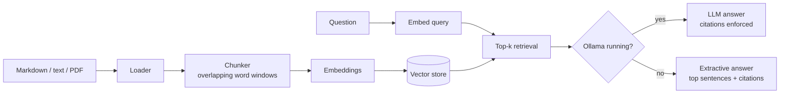

# Local RAG Document Q&A

Ask questions about a folder of local documents and get answers that cite the exact chunk they came
from. Nothing leaves the machine: generation uses a local [Ollama](https://ollama.com) model, and if
Ollama isn't running the system falls back to a deterministic extractive answerer, so it still works
(and is testable) on a fresh laptop.



## Quick start (no Ollama needed)

```bash
cd local-llm-document-qa-rag
python -m venv .venv && source .venv/bin/activate   # Windows: .venv\Scripts\activate
pip install -e ".[dev]"

python -m rag_app.cli ingest --docs data/docs --store .rag_store
python -m rag_app.cli ask --store .rag_store --question "What happens when Ollama is unavailable?"
```

Sample answer (shortened). Every sentence carries a `source#chunk-id` citation:

```text
When the Ollama API is not reachable, the answer generator uses an extractive fallback that selects
the most relevant sentences from retrieved chunks. [ollama_setup.md#c0000-844c77935b]
...
```

The full JSON output also lists the retrieved chunks with their similarity scores and which answerer was used (`used_llm`).

## Evaluation

```bash
python -m rag_app.evaluate --docs data/docs --store .rag_store --eval-file data/eval/questions.jsonl
```

Each line of the eval file lists a question, the source(s) that *should* be retrieved, and keywords the answer should contain:

```json
{"question": "How are answers grounded?", "expected_sources": ["rag_architecture.md"], "expected_keywords": ["citations", "retrieved"]}
```

| Metric | Meaning | Bundled set (3 questions, default settings) |
|---|---|---|
| `retrieval_relevance` | expected source appears in the top-k results | 1.00 |
| `answer_keyword_coverage` | share of expected keywords present in the answer | 1.00 |
| `approx_hallucination_rate` | share of answer sentences where under 30% of the content words appear in the retrieved text | 0.13 |

The bundled corpus is tiny (3 documents), so these numbers show the harness works rather than measure
quality. The harness is meant for comparing chunk sizes, embedding backends and `top_k` on your own documents.

## Full local-LLM mode

```bash
pip install -e ".[full,dev]"        # sentence-transformers, chromadb, pypdf
ollama pull llama3.1:8b && ollama serve

python -m rag_app.cli ingest --docs data/docs --store .rag_store \
  --embedding sentence-transformer --store-backend chroma
python -m rag_app.cli ask --store .rag_store --llm ollama --model llama3.1:8b \
  --embedding sentence-transformer --store-backend chroma \
  --question "What does the RAG pipeline store in ChromaDB?"
```

The prompt tells the model to answer only from the retrieved snippets and to cite every factual
sentence. If the model's reply has no citations, the sources are appended, so answers stay auditable.

## CLI reference

| Option | Default | Notes |
|---|---|---|
| `--store` | `.rag_store` | where the index is persisted |
| `--embedding` | `hashing` | `hashing` (384-dim, no model download) or `sentence-transformer` (`all-MiniLM-L6-v2`) |
| `--store-backend` | `json` | `json`, `chroma`, or `auto` |
| `--llm` | `auto` | `auto` (Ollama, falling back to extractive), `ollama` (error if unreachable), `extractive` |
| `--model` | `llama3.1:8b` | Ollama model name |
| `ingest --docs` / `--chunk-size` / `--overlap` | `data/docs` / 180 / 40 | chunk size and overlap are in words |
| `ask --question` / `--top-k` | — / 4 | |

Use the same `--embedding` and `--store-backend` for `ingest` and `ask`.

## HTTP API

```bash
uvicorn rag_app.api:app --port 8000      # interactive docs at http://localhost:8000/docs
```

| Endpoint | Body | Returns |
|---|---|---|
| `GET /health` | — | `{"status": "ok"}` |
| `POST /ingest` | `{"docs_path": "data/docs", "chunk_size": 180, "overlap": 40, "reset": true}` | document and chunk counts |
| `POST /ask` | `{"question": "...", "top_k": 4}` | answer, citations, retrieved contexts with scores |

```bash
curl -X POST localhost:8000/ingest -H "Content-Type: application/json" -d '{}'
curl -X POST localhost:8000/ask -H "Content-Type: application/json" \
  -d '{"question": "How are answers grounded?", "top_k": 4}'
```

`/ingest` only accepts paths inside `RAG_DOC_DIR`, so the API can't be used to read other files on the server.

| Environment variable | Default |
|---|---|
| `RAG_DOC_DIR` | `data/docs` |
| `RAG_STORE_DIR` | `.rag_store` |

**Docker:** `docker build -t local-rag . && docker run -p 8000:8000 local-rag` builds the index from the bundled docs at image build time.

## Code map

```text
src/rag_app/document_loader.py   .md / .txt / optional .pdf loading
src/rag_app/chunker.py           overlapping word chunks with stable, content-hashed ids
src/rag_app/embeddings.py        hashing embeddings + optional sentence-transformer adapter
src/rag_app/vector_store.py      JSON store (cosine similarity) + optional ChromaDB adapter
src/rag_app/llm.py               Ollama client, citation enforcement, extractive fallback
src/rag_app/pipeline.py          ingest / ask orchestration
src/rag_app/evaluate.py          evaluation harness
src/rag_app/api.py, cli.py       FastAPI service and command line
tests/                           chunking, pipeline, evaluation and API tests
```

```bash
python -m unittest discover -s tests
```

## Limitations

- The default hashing embeddings match on shared words, not meaning. Use `--embedding sentence-transformer` for semantic retrieval.
- The JSON store does a linear scan, which is fine for hundreds of chunks. Use ChromaDB beyond that.
- `approx_hallucination_rate` is a lexical heuristic, not a factuality judgment.
