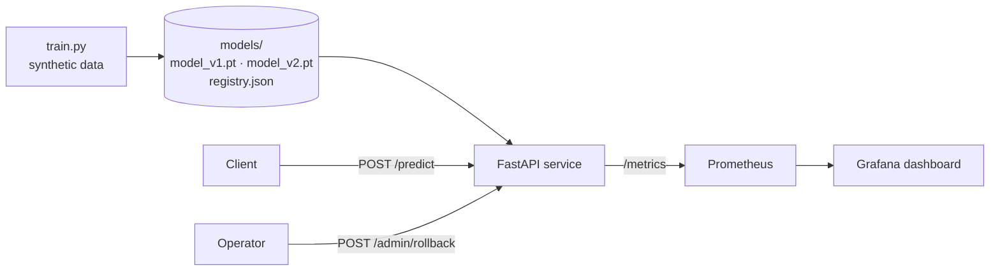

# ML Model Deployment Pipeline

A PyTorch classifier taken from training to a monitored HTTP service: versioned model artifacts, a
file-backed registry with one-call rollback, a FastAPI prediction API, and Prometheus metrics
(latency, throughput, predicted-class mix, feature drift) with a provisioned Grafana dashboard.

The model scores how risky an account event looks from four features. The data is synthetic, so
the point is the deployment mechanics, not the model.



## Quick start

```bash
cd ml-model-deployment-pipeline
python -m venv .venv && source .venv/bin/activate   # Windows: .venv\Scripts\activate
pip install -e ".[dev]"
python -m pytest -q
uvicorn ml_service.app:app --port 8080              # docs at http://localhost:8080/docs
```

Two small trained models (`v1`, `v2`) are committed, so the API starts right away with `v2` active.

```bash
curl -X POST localhost:8080/predict -H "Content-Type: application/json" -d '{
  "account_age_days": 45, "failed_login_count": 7,
  "transaction_amount": 420.0, "device_trust_score": 0.22 }'
```

```json
{"model_version": "v2", "probability": 0.9998, "label": 1, "threshold": 0.5, "drift_score": 2.06}
```

A long-lived account with no failed logins on a trusted device scores the opposite way (`probability ≈ 0.00002`, `label: 0`).

## Rollback

The registry records which versions have been deployed, in order. Rolling back activates the
previous version and hot-reloads it, with no restart:

```bash
curl -X POST localhost:8080/admin/rollback
# {"active_version": "v1", "message": "Rolled back to v1"}
```

Rollback changes `models/registry.json` on disk, so `git checkout models/registry.json` undoes it locally.
Set `ADMIN_TOKEN` to protect the endpoint; callers then need an `X-Admin-Token: <value>` header.

## Monitoring

```bash
docker compose up --build
```

| Service | URL |
|---|---|
| API | http://localhost:8080/docs |
| Prometheus | http://localhost:9090 |
| Grafana (admin / admin, local only) | http://localhost:3000 |

The provisioned dashboard shows **prediction throughput, p95 latency, feature drift score, and active model version**.

| Metric | Type | What it tracks |
|---|---|---|
| `ml_service_requests_total{endpoint,method,status}` | counter | every request |
| `ml_service_predictions_total{model_version,label}` | counter | predicted-class mix per model |
| `ml_service_prediction_latency_seconds` | histogram | inference latency |
| `ml_service_prediction_drift_score` | gauge | mean absolute z-score of the last 200 requests' feature means vs. training statistics |
| `ml_service_active_model_info{model_version}` | gauge | 1 for the active version |

## API reference

| Endpoint | Purpose |
|---|---|
| `GET /health` | status and active model version |
| `GET /model/info` | active and available versions, feature names, threshold |
| `POST /predict` | risk probability, label, and current drift score; inputs are range-checked (e.g. `device_trust_score` must be 0–1) |
| `POST /admin/rollback` | switch to the previously deployed version (409 if there isn't one) |
| `GET /metrics` | Prometheus exposition |

| Environment variable | Default | |
|---|---|---|
| `MODEL_DIR` | `./models` | where checkpoints and `registry.json` live |
| `ADMIN_TOKEN` | unset | if set, required as `X-Admin-Token` for rollback |

## Retraining

```bash
python -m ml_service.train --model-dir models --versions v1 v2 --epochs 5
```

Trains one 4 → 12 → 12 → 1 MLP per version on 1,200 synthetic rows (a different seed per version).
Each checkpoint stores its weights along with the feature order, training mean/std (used for drift)
and decision threshold. The service checks the feature order on load and loads checkpoints with
`torch.load(weights_only=True)`, so a tampered file can't run code. The recorded accuracy
(~0.93) is training accuracy on synthetic data, not a held-out evaluation.

## Code map

```text
src/ml_service/train.py       synthetic data + training, writes versioned checkpoints
src/ml_service/model.py       RiskNet and the Predictor that loads checkpoints
src/ml_service/registry.py    active version, deployment history, rollback
src/ml_service/app.py         FastAPI service
src/ml_service/monitoring.py  Prometheus metrics and drift monitor
src/ml_service/features.py    canonical feature order
monitoring/                   Prometheus scrape config and Grafana provisioning
```

Tests cover feature ordering, rollback (including when there's no previous version), the prediction
API, and the admin-token check. They run in the repo-level GitHub Actions workflow.

## Limitations

- Single process: the registry is a JSON file and the drift window lives in memory.
- Drift is a mean-shift signal only. It won't catch changes in variance or in how features relate to each other.
