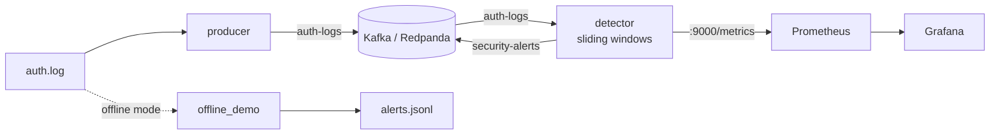

# Real-Time Security Log Detection

Reads OpenSSH authentication logs and raises alerts for three suspicious patterns. It runs offline
against a log file, or as a streaming detector that consumes events from Kafka and publishes alerts
back to Kafka, with Prometheus metrics and a Grafana dashboard.

| Alert | Severity | Fires when (defaults) |
|---|---|---|
| `BRUTE_FORCE` | HIGH | 5 failed logins for the same user from the same IP within 5 minutes |
| `NEW_DEVICE_LOGIN` | MEDIUM | a user who has logged in before succeeds from an IP never seen for them |
| `SUCCESS_VELOCITY` | MEDIUM | one user logs in successfully from 3+ distinct IPs within 10 minutes |

Each alert type is suppressed for 5 minutes per user + IP after it fires, so a long attack produces one alert, not hundreds.



## Quick start (no Kafka)

```bash
cd real-time-security-log-detection-pipeline
python -m venv .venv && source .venv/bin/activate   # Windows: .venv\Scripts\activate
pip install -e ".[dev]"
python -m security_pipeline.offline_demo --input data/sample_auth.log --output alerts.jsonl
```

```json
{"events_processed": 9, "alerts_emitted": 4, "output": "alerts.jsonl"}
```

The 9-line sample log is built to trigger each rule once or more. Here is one alert from `alerts.jsonl`:

```json
{"alert_type": "BRUTE_FORCE", "severity": "HIGH", "username": "root", "source_ip": "203.0.113.10",
 "reason": "5 failed SSH authentication events for user 'root' from 203.0.113.10 within 300 seconds",
 "evidence": {"failed_count": 5, "window_seconds": 300}, "timestamp": "2026-06-12T10:01:40", "alert_id": "722303b37f7142e4"}
```

The other three are two `NEW_DEVICE_LOGIN` alerts and a `SUCCESS_VELOCITY` alert for `alice` signing in from 3 IPs in 2 minutes.

Run it on a real server's log (read access is all it needs):

```bash
python -m security_pipeline.offline_demo --input /var/log/auth.log --output alerts.jsonl --brute-force-threshold 10
```

## Streaming mode

```bash
docker compose up --build
```

| Service | Role | Address |
|---|---|---|
| Redpanda | Kafka-compatible broker | `localhost:9092` |
| producer | replays `data/sample_auth.log` into `auth-logs`, one line per second | — |
| detector | consumes `auth-logs`, publishes to `security-alerts`, exposes metrics | `:9000/metrics` |
| Prometheus | scrapes the detector | http://localhost:9090 |
| Grafana (admin / admin, local only) | events processed, alerts by type, last event time | http://localhost:3000 |

To run the pieces yourself against any broker:

```bash
python -m security_pipeline.producer --bootstrap-servers localhost:9092 --input data/sample_auth.log --topic auth-logs --delay 0.25
python -m security_pipeline.consumer --bootstrap-servers localhost:9092 --input-topic auth-logs --alert-topic security-alerts --metrics-port 9000
```

| Metric | Type |
|---|---|
| `security_pipeline_events_processed_total{outcome}` | counter |
| `security_pipeline_alerts_emitted_total{alert_type,severity}` | counter |
| `security_pipeline_last_event_timestamp_seconds` | gauge |

## What the parser understands

Standard syslog-format `sshd` lines:

- `Failed password for <user> from <ip> port <n>` (including `for invalid user <user>`)
- `Accepted password|publickey for <user> from <ip> port <n>`
- `Invalid user <user> from <ip> port <n>`

Other lines are skipped. To create a fresh synthetic log, run `python -m security_pipeline.generate_logs --output data/sample_auth.log`.

## Code map

```text
src/security_pipeline/log_parser.py         syslog + sshd message parsing into AuthEvent
src/security_pipeline/detector.py           DetectionEngine: sliding windows, rules, cooldown
src/security_pipeline/offline_demo.py       file in, JSONL alerts out
src/security_pipeline/producer.py           log file -> Kafka
src/security_pipeline/consumer.py           Kafka -> detector -> Kafka, plus metrics server
src/security_pipeline/prometheus_metrics.py metric definitions
monitoring/                                 Prometheus and Grafana provisioning
```

```bash
python -m unittest discover -s tests
```

Tests cover parsing, each detection rule, and an end-to-end run of the offline demo on the sample log.

## Limitations

- IPv4 only. IPv6 source addresses aren't parsed yet.
- Syslog lines carry no year, so the parser assumes the current one. Replaying an old log around New Year can misorder events.
- Detector state is in memory and isn't shared across consumer instances. A restart forgets known IPs.
- Real logs contain usernames and IP addresses. Redact them before sharing alerts or log samples.
